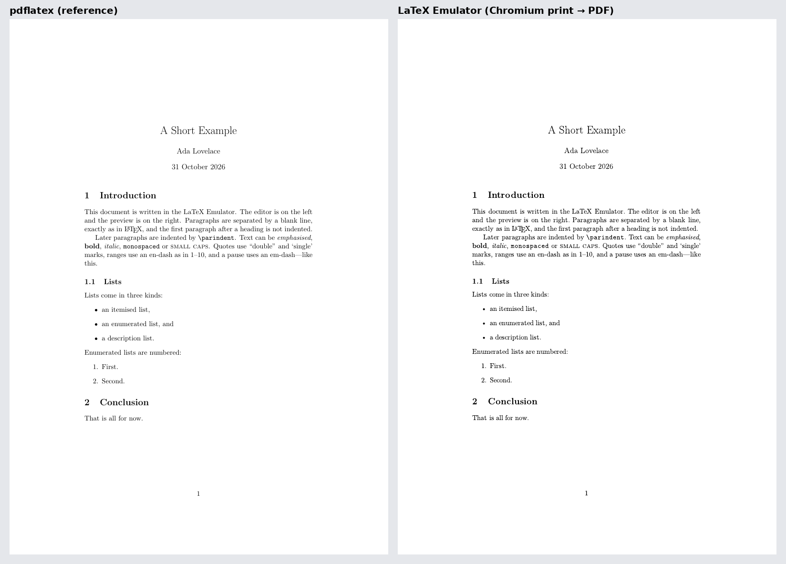

# LaTeX Emulator

**Live:** https://sholtomaud.github.io/latex-emulator/ (deployed from `main` by GitHub Actions)

A Progressive Web App for writing LaTeX in the browser, with live linting,
spell checking, a LaTeX-faithful preview and a print-CSS PDF download. It is
built on [Boba](https://github.com/sholtomaud/boba). It doesn't run TeX: it
emulates a well-defined subset of LaTeX with native browser technology.

**Status:** a document workspace (VS Code-style explorer, autosave in the
browser, `.tex` import and download), versioned snapshots with preprint PDFs
stamped with a SHA-256 checksum, the Monaco editor with live error markers,
and a print-faithful `article` layout are in place. Next: citations.

To check that a preprint matches its source, download that version's `.tex`
and compare its hash with the PDF footer:

```bash
shasum -a 256 a-short-example-v0.1.0.tex   # first 16 hex digits = the footer
```



*Left: real `pdflatex`. Right: this app's PDF, printed by Chromium. The same
lines break in the same places; positions agree to within about 1pt.*

## Getting started

Requires Node.js ≥ 25.

```bash
npm install
npm run dev
```

## Testing

This project is test-driven. See [`AGENTS.md` §10](AGENTS.md#10-test-driven-development-and-testing).

```bash
npm test                 # unit tests
npm run test:coverage    # unit tests + coverage gate
npm run e2e:smoke        # smoke tests (production build)
npm run e2e              # functional e2e (dev + production)
npm run e2e:visual       # visual snapshots (needs Docker)
npm run e2e:pages        # GitHub Pages build under /latex-emulator/
```

## Contributing

Read [`AGENTS.md`](AGENTS.md) first. It's the project's rulebook for humans and
AI agents alike.
